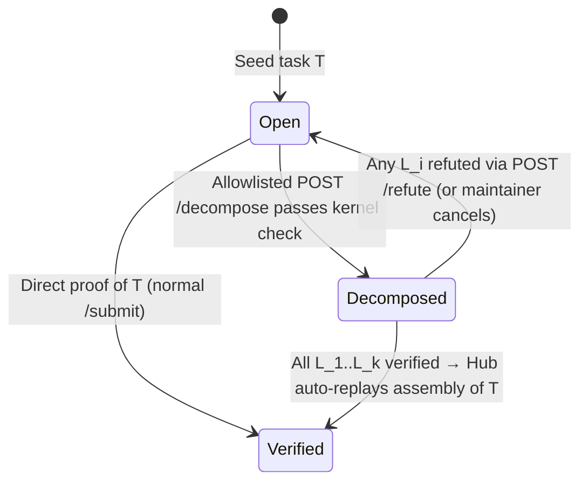

# RFC: Kernel-Verified `decompose` & Disproofs for Hard Open Theorems

> **Status:** Draft RFC (v2 design)  
> **Scope:** Extending Sunstead's Lean 4 DAG missions with trustless theorem decomposition (`POST .../decompose`) and kernel-verified refutations (`POST .../refute`), without weakening any Section-4 security or provenance invariant in [docs/DESIGN.md](./DESIGN.md).

---

## 1. Motivation & Design Principles

Today, every node in a Sunstead mission DAG must be decomposed ahead of time by a human curator down to a single-submission `sorry`. That works well for medium-sized blueprint lemmas (like `PrimeNumberTheoremAnd`'s `isCompletelyMultiplicative_liouville`), but hits a ceiling on deep open targets such as `Verified-zkEVM/ArkLib`'s `NearCapacityPrimeSupply` (Issue #1352), whose proof requires substantial intermediate machinery (e.g., primes in arithmetic progressions / Linnik-type or Bombieri–Vinogradov-style bounds) before assembling the final existential witness.

This RFC specifies a **kernel-verified `decompose` primitive** so hard open targets can grow a structured proof graph dynamically while holding up to adversarial scrutiny.

### Non-Negotiable Principles

1. **Strictly solver-agnostic:** Sunstead never prescribes *who* decomposes or *who* proves any node, or *how* they search (human mathematician, local prover, frontier coding agent, custom tactic script). The Lean 4 kernel is the only arbiter.
2. **Gated decomposition proposals to protect contributor compute:** A syntactically valid reduction $L_1 \land \dots \land L_k \to T$ can still be useless or actively harmful if one of the $L_i$ is false (e.g., $L_1 := \text{False}$) or mis-stated, wasting other contributors' time chasing unprovable subgoals.
   - **Phase 1 (Launch):** Explicit **maintainer allowlist** (`decomposition_allowlist`) controls who may submit `POST .../decompose`.
   - **Phase 2 (Future experiment):** Optionally graduate to **reputation-gated eligibility** (e.g., contributors with $\ge N$ accepted proofs on non-demo upstream missions and zero refuted/retracted decompositions), with automatic revocation if a proposed subgoal is kernel-refuted.
3. **Zero trust in the proposer's glue proof:** The reduction $L_1 \land \dots \land L_k \to T$ is replayed from scratch through the Lean 4 kernel (`SunsteadCheck`), with `0 sorry` and standard axioms only (`propext`, `Classical.choice`, `Quot.sound`).
4. **First-class kernel-verified refutations (`¬ L_i`):** Any contributor (no allowlist needed) may submit a kernel-verified proof of `¬ L_i` for an open spawned subgoal. A verified disproof immediately invalidates the broken decomposition, reopens the parent target `T`, awards a refutation bounty, and flags the proposer's decomposition status for review.
5. **End-to-end `history.mbox` & independent `leanchecker` reproducibility:** Once every subgoal $L_1, \dots, L_k$ is proved, the combined proof of $T$ must replay cleanly as ordinary, sorry-free Lean 4 code via `bundle.tar.gz?base=seed` + `history.mbox | git am` + stock `lake build` + `leanchecker`.

---

## 2. Kernel Verification Model for `decompose`

### 2.1 What a Decomposition Submission Contains

Given an open, unlocked, non-verified DAG task `T` whose frozen statement in `SunsteadStatements` is `SunsteadStatements.T : Prop`, an allowlisted contributor submits:

```json
{
  "subgoals": [
    {
      "id": "linnik_dyadic_ap",
      "title": "Primes ≡ 1 (mod 2^K) in dyadic intervals",
      "statement": "def linnik_dyadic_ap : Prop := ..."
    },
    {
      "id": "beta_margin_select",
      "title": "Choose β > max(c + 2, 12/5) compatible with Linnik exponent",
      "statement": "def beta_margin_select : Prop := ..."
    }
  ],
  "reduction_file": "ArkLibNearCapacity/Decomp_near_capacity_prime_supply_d1.lean",
  "patch": "diff --git ..."
}
```

Constraints enforced **before** waking the verifier container:
- `2 <= subgoals.length <= 6` (a 1-subgoal split is always rejected as a trivial rename/pass-through).
- Decomposition depth `<= MAX_DECOMPOSE_DEPTH` (`2` in v2.0; prevents unbounded nesting).
- At most **one active decomposition** per target `T` at a time (prevents graph explosion and splits contributor effort only intentionally).
- Each subgoal `statement` passes strict size cap ($\le 4\text{ KB}$) and source-hygiene linting (`lint_lean_file`: no `sorry`, no `axiom`, no `def`/`structure`/`opaque`, no macros/elaborators/`#eval`/`unsafe`/`module`, only imports from the mission's frozen `Spec` and allowed library prefixes).

### 2.2 Anti-Vacuity & Symbol-Scope Isolation (Critical Trust Boundary)

A subtle way to game or corrupt a decomposition is introducing custom contributor-defined symbols inside `L_1 .. L_k` (or sneaking `sorry` or tactic-level metaprogramming such as `by run_tac` / `by_elab` into a subgoal statement).

To close this completely without ever running proposer-controlled Lean elaboration under `sunstead-checker`:
- Every subgoal statement `L_i` passes strict source-hygiene linting (`lint_subgoal_statement`: bans `by`, `do`, `run_tac`, `by_elab`, `run_cmd`/`run_elab`/`run_meta`, `#eval`/`#check`/..., macros, elaborators, `sorry`/`sorryAx`, `axiom`/`opaque`/`unsafe`, attributes, imports, and nested declarations).
- Generated `<Lib>.DecompStatements_<T>_<d>.lean` imports **ONLY** the mission's frozen `<Lib>.Spec` (plus any frozen `statement_preamble` opens) and **ZERO contributor modules**, and is elaborated strictly as **`sunstead-runner`** (unprivileged, isolated directory, rlimits, followed immediately by `ensure_no_processes(sunstead-runner)`).
- Its resulting `.olean` is snapshotted (rejecting symlinks and `.olean.private`/`.olean.server` sidecars) into `sunstead-checker`-owned read-only storage before the contributor's proof module compiles, and `SunsteadCheck` loads it via `readModulePartsChecked` + **`Kernel.Environment.replay`** (never trusting it via `importModules`), rejecting any non-frozen imports, axioms, opaques, or unsafe definitions.
- Each `L_i` must be a safe, monomorphic `Prop` definition with **zero `sorryAx`** and **standard axioms only** (`propext`, `Classical.choice`, `Quot.sound`) in the statement itself.
- **Anti-triviality & hypothesis-usage checks (best-effort anti-gaming heuristics, not soundness):**
  - No `L_i` may be definitionally equal to `True`, `False`, the parent statement `SunsteadStatements.T`, or an earlier `L_j`.
  - Every `L_i` must remain referenced after best-effort usage reduction (`reduceForUsage`: beta/zeta, projections, `id`/`Function.const`, `And`/`Prod`/`PProd`/`Exists` dead projections, trivial `congrArg`/`Eq.mp`/`Eq.mpr`/`Eq.rec`/`Eq.ndrec`, and identical-branch `ite`/`dite`).
  - Note: checking semantic equivalence (`L_i ↔ True`, `L_i ↔ T`, e.g. `1 = 1` or `T ∧ True`) or semantic dependence on `h_i` through arbitrary non-unfolded library constants is undecidable in general. **Soundness** is still 100% guaranteed by the Lean kernel (`L_1 → ... → L_k → T` plus final untouched `./verify <T>`), while anti-gaming beyond these syntactic/def-eq guards is enforced economically and operationally via the **Phase 1 allowlist**, **zero-inflation point split**, **vest-on-closure architect share**, and **refutation strikes**.

### 2.3 Checking the Reduction Proof (`L_1 → ... → L_k → T`)

1. **`sunstead-checker` (Step 1a — trusted frozen baseline):** Uses cached or freshly compiled frozen `<Lib>.Spec` + `<Lib>.SunsteadStatements` `.olean`s (containing zero contributor text).
2. **`sunstead-runner` (Step 1b — untrusted, UID 10002):** Elaborates `<Lib>.DecompStatements_<T>_<d>.lean` against read-only frozen `Spec.olean` only, kills all runner processes (`ensure_no_processes`), and snapshots the resulting `.olean` into `sunstead-checker`-owned read-only storage before deleting the runner's build directory.
3. **`sunstead-runner` (Step 2 — untrusted, UID 10002):** Compiles the proposer's reduction module `<Lib>.Decomp_<T>_<d>.lean` against the read-only `Spec.olean` + snapshotted `DecompStatements_<T>_<d>.olean` with all normal rlimits and hygiene checks (`0 sorry`, no macros, no `run_tac`/`by_elab`, no `unsafe`, no `module`).
4. **`ensure_no_processes(sunstead-runner)`** kills all runner processes.
5. **`sunstead-checker` (Step 3 — trusted, UID 10003):** Invokes `sunstead-check` (`loadExts := false`) to:
   - Read `DecompStatements_<T>_<d>.olean` from `untrusted-decomp-lib` (never via `importModules`), verify zero non-frozen imports and zero `axiom`/`opaque`/unsafe constants, replay all its constants through `Kernel.Environment.replay`, and run `checkDecompSubgoalsM`.
   - Replay all contributor constants in `Decomp_<T>_<d>.olean` through `Kernel.Environment.replay`.
   - Assert the kernel accepts:
     ```lean
     theorem _sunstead_decomp_check :
         L_1 → ... → L_k → SunsteadStatements.<T> :=
       <Lib>.<target_reduction_theorem>
     ```
   - Assert `collectAxioms _sunstead_decomp_check ⊆ {propext, Classical.choice, Quot.sound}` (`0 sorryAx`!).
   - Run best-effort usage reduction verifying every hypothesis `h_1 .. h_k` is referenced.

Notice how **little new TCB code** this requires: it preserves 100% of our 3-principal `sunstead-runner` / `sunstead-checker` isolation (zero proposer text is ever elaborated as `sunstead-checker`) and replays every untrusted `.olean` through `SunsteadCheck`'s `Kernel.Environment.replay`!

---

## 3. DAG, `frozen_paths`, and `history.mbox` Integration

### 3.1 Lifecycle of a Decomposed Node



1. **When `POST /api/missions/:id/tasks/:T/decompose` succeeds:**
   - The decomposition record is stored in SQLite (`decompositions` table: `decomp_id`, `mission_id`, `parent_task_id`, `proposer`, `reduction_patch`, `reduction_sha256`, `status = 'active'`, `created_at`).
   - `k` child tasks `<T>__d<n>__<sub_id>` are inserted into `tasks` with `parent_task_id = T`, `decomp_id = d`, `status = 'open'`, and frozen statement specs pinned to `spec_sha256`.
   - Each child task gets its own target file `<Lib>/Decomp_<T>_d<n>_<sub_id>.lean` seeded with a clean `sorry` stub matching `L_i`.
   - The parent task `T` remains **directly solvable too** (optional policy toggle: `allow_direct_bypass = true` by default — if someone submits a direct proof of `T` before all subgoals close, `T` closes immediately and open child nodes retire cleanly!). Alternatively, `T` shows its spawned subgraph on the Blueprint canvas with dashed "decomposition" edges so contributors immediately see both `T` and its subgoals `L_1 .. L_k`.
   - **Critical `frozen_paths` invariant:** The original mission's `spec_sha256` over upstream `frozen_paths` NEVER changes. Each spawned subgoal carries its own immutable `subgoal_spec_sha256` derived from `Spec.lean` + `L_i`'s exact statement text, and the reduction file itself is frozen for the duration of the decomposition so subgoal solvers cannot weaken the glue theorem.

2. **When the final subgoal `L_k` is verified:**
   - The Hub invokes the verifier container one final time to assemble the target file `<T_target>.lean` (importing the verified `L_1 .. L_k` modules and applying the verified reduction proof to close `<T>` with `0 sorry`), re-running the original frozen `./verify <T>` end-to-end!
   - **Why this is awesome:** The original `./verify <T>` and `SunsteadCheck` certify the assembled proof of `T` against the *exact* original frozen upstream statement — meaning **even if there were a bug in decomposition tracking, the final acceptance of `T` still passes the untouched v1 verifier!**

3. **Clean `history.mbox` & Upstream Export:**
   - While a decomposition is in progress, subgoal proofs are recorded in `accepted_patches` (visible in the Verified Proofs Ledger `/proofs` with full per-subgoal attribution).
   - If a decomposition is **refuted** (`¬ L_i`), its unmerged scratch files are never committed to `T`'s final tree; `history.mbox` stays clean (or marks the decomposition branch superseded).
   - Once `T` closes via assembly, the final commit in `history.mbox` applies cleanly onto `bundle.tar.gz?base=seed` and compiles with stock `lake build` + `leanchecker` with **zero `sorry`**. Upstream export bundles include `Co-authored-by:` trailers crediting the decomposition proposer and every subgoal solver!

---

## 4. Kernel-Verified Disproofs (`POST .../refute`)

Even skilled humans and strong models occasionally write a plausible-looking intermediate lemma `L_i` with a missing hypothesis (e.g., forgetting `K ≥ 1` or an off-by-one boundary condition). Without a refutation mechanism, contributors could waste hours trying to prove a false statement.

- **Endpoint:** `POST /api/missions/:id/tasks/:task/refute` (authenticated, open to **all** registered contributors — no allowlist required).
- **What the verifier checks:** Replays a proof of `¬ (SunsteadDecomp.L_i)` (or `¬ (SunsteadStatements.T)` on a root upstream task) through `SunsteadCheck` with `0 sorry` and standard axioms only.
- **Effect on a spawned subgoal `L_i`:**
  - Marks the active decomposition `status = 'refuted'` (storing the verified counterexample patch permanently in the ledger so everyone can learn from the bug).
  - Retires the sibling open subgoals cleanly and restores `T` to `open`.
  - Awards a refutation bounty (e.g., `75 pts` on Tier 1 missions) to the refuter.
  - Records a strike against the proposer's decomposition reliability score (pausing automated eligibility if enabled, and alerting maintainers on allowlisted accounts).
- **Effect on a root upstream task `T`:**
  - Does **not** auto-delete the mission; marks `T` with a `disputed_counterexample` badge and surfaces the kernel-verified proof of `¬ T` for maintainers to report upstream as a genuine formalization bug!

---

## 5. Access Gating, Anti-Gaming & Economics

### 5.1 Phased Access Gating for `decompose`

| Phase | Who can call `POST .../decompose` | Safeguards |
| :--- | :--- | :--- |
| **Phase 1 (v2.0 launch)** | Explicit **maintainer allowlist** (`decomposition_allowlist` table in `SunsteadHub`, managed via admin endpoint) | Max 1 active decomposition per target, max 3 active decompositions per contributor, max depth 2, 2–6 subgoals |
| **Phase 2 (opt-in experiment)** | Allowlist **plus** contributors who meet reputation threshold (e.g., $\ge 3$ verified non-demo Tier 1 proofs, `0` unreviewed refuted decompositions in last 30 days) | Automatic suspension of decomposition privilege on 1 refuted split until maintainer review; stricter rate limit (e.g. 2/week) |

### 5.2 Point-Splitting Economics (Zero-Inflation, Pay-on-Completion)

Suppose parent task `T` is worth $P$ points (e.g., $P = 250$ for a Tier 1 task).

- **At decomposition submission time:** Proposer receives **`0` points**. Submitting a decomposition *never* mints immediate reward.
- **As each subgoal $L_i$ ($i = 1, \dots, k$) is verified:**
  - The solver of $L_i$ receives $\lfloor 0.80 \cdot P / k \rfloor$ points.
  - The proposer's architect share ($\lfloor 0.20 \cdot P \rfloor$ total) vests **only when `T` actually closes** (i.e., when all $L_1, \dots, L_k$ are proved and the final assembly of `T` passes `./verify <T>`).
  - If the proposer themselves proves one of their own subgoals $L_i$, they earn that subgoal's solver share too, so self-decomposing + solving everything pays at most $P$ — **never more than proving `T` directly** (zero point-inflation!).
- **If a decomposition is refuted (`¬ L_i`) or bypassed by a direct proof of `T`:**
  - Unvested architect share is forfeited (`0 pts`).
  - Solvers who already contributed a valid, kernel-verified proof of a *true* sibling lemma $L_j$ keep a small partial credit (capped, e.g., already-awarded $\lfloor 0.80 \cdot P / k \rfloor$ is only paid if $L_j$ is non-trivial, or escrowed until `T` closes — **recommended default: pay solver immediately on verified $L_j$ ONLY for allowlisted decompositions**, where false splits are rare, and escrow if Phase 2 reputation-gating opens up!).

---

## 6. Worked Example: `ArkLibNearCapacity.NearCapacityPrimeSupply`

Recall the frozen statement in [ArkLibNearCapacity/Spec.lean](../missions/arklib-near-capacity-primes/ArkLibNearCapacity/Spec.lean):

```lean
def NearCapacityPrimeSupply (c : ℝ≥0) : Prop :=
  ∃ β : ℝ, max ((c : ℝ) + 2) (12 / 5) < β ∧ ∀ K₀ : ℕ, ∃ K ≥ K₀, ∃ p : ℕ,
    p.Prime ∧ 2 ^ K ∣ p - 1 ∧ ((2 : ℝ) ^ K) ^ β ≤ p ∧ (p : ℝ) ≤ 2 * ((2 : ℝ) ^ K) ^ β
```

An allowlisted contributor could propose a 2- or 3-subgoal decomposition such as:
1. **`L1` (`exists_prime_in_dyadic_ap_pow_two`):** There exist explicit constants $B \ge 3$ and $K_{\min}$ such that for every $K \ge K_{\min}$ and every real $\beta \ge B$, there exists a prime $p \equiv 1 \pmod{2^K}$ with $(2^K)^\beta \le p \le 2 (2^K)^\beta$.
2. **`L2` (`exists_beta_gt_max_and_bound`):** Auxiliary real-arithmetic / monotonic threshold lemma (or further split `L1` into an explicit Chebyshev/character-sum lower bound for $\psi(x; 2^K, 1)$ plus a zero-free/Page-Siegel estimate for modulus $2^K$).
3. **Reduction proof (checked by `SunsteadCheck` with `0 sorry`):** Given `h1 : L1` and `h2 : L2`, choose $\beta = \max(B, \max(c + 2, 12/5) + 1)$ and $K = \max(K_0, K_{\min})$, directly discharging `NearCapacityPrimeSupply c`.

Now any contributor can attack `L1` (or further decompose `L1` at depth 2) independently, while knowing with **mathematical certainty** that closing `L1` + `L2` closes ArkLib Issue #1352.

---

## 7. Red-Team Attack Matrix

Every attack below must have a dedicated regression case in `scripts/redteam.py` before `decompose` ships in production:

| Attack | Goal of Attacker | Defense |
| :--- | :--- | :--- |
| **Vacuous split (`L_1 := False`)** | Farm points or grief contributors with an unprovable subgoal | Zero points at decompose time; `L_i = False` rejected syntactically/def-eq; allowlist gating; `POST /refute` (`¬ L_i`) kills split and penalizes proposer |
| **Hidden `def` smuggling** | Define `def P := True` in contributor file and put `P` in `L_i` | `DecompStatements` elaborates as `sunstead-runner` importing ONLY frozen `Spec` (never contributor files), then is snapshotted and kernel-replayed by `SunsteadCheck` |
| **Metaprogramming / IO in subgoal text (`by run_tac` / `by_elab`)** | Execute arbitrary IO or tamper with frozen `.olean`s during `DecompStatements` elaboration | `lint_subgoal_statement` + `LEAN_FORBIDDEN_ALWAYS_CORE` ban `by`/`do`/`run_tac`/`by_elab`; `DecompStatements` elaborates strictly as unprivileged `sunstead-runner` (zero write access to `checker_dir`/frozen cache), runner processes are killed, and `SunsteadCheck` kernel-replays `DecompStatements` from scratch (`loadExts := false`, rejecting axioms/opaques/unsafe defs) |
| **Trivial pass-through (`L_1 := T`, `L_2 := True`)** | Farm architect share without real mathematical progress | Reject `k < 2`, reject `L_i` def-eq to `True`/`False`/`T`/duplicates, best-effort usage reduction requiring all `h_1 .. h_k`, plus allowlist + zero extra points above $P$ + vest-on-closure |
| **Sorry / axiom / macro in glue proof** | Accept an unsound reduction `L_1 ∧ L_2 → T` | Full `lint_lean_file` + `SunsteadCheck` `Kernel.Environment.replay` with `0 sorryAx` and standard axioms only |
| **Subgoal solver edits reduction file** | Weakens `Decomp_<T>_d1.lean` to bypass `L_1` | Reduction file is frozen in `subgoal` verification; final closure re-runs original untouched `./verify <T>` |
| **Graph-explosion spam** | Flood blueprint with 100 overlapping decompositions | Allowlist gating + max 1 active decomposition per target + max depth 2 + per-contributor active cap |
| **False refutation spoofing** | Spoof `¬ L_i` to sabotage a valid decomposition | `POST /refute` runs exact same isolated `SunsteadCheck` kernel replay against `¬ L_i` with `0 sorry` and standard axioms only |

---

## 8. Minimal Implementation Roadmap (v2)

1. **Verifier (`SunsteadCheck.lean` + `sunstead_sandbox.py`):** Add `mode=decompose` (check `reduction_goal` + non-triviality + binder usage) and `mode=refute` (check `¬ statement`), plus 7+ new attack cases in `scripts/redteam.py`.
2. **Core & Hub (`core.ts` + `hub_do.ts`):** Add `decomposition_allowlist` and `decompositions` SQLite tables, `POST .../decompose`, `POST .../refute`, admin allowlist management, and automatic final assembly verification on last-subgoal closure.
3. **UI (`web/app.js` + `web/styles.css`):** Render active decompositions as collapsible sub-clusters with dashed reduction edges on the Blueprint DAG, and show refutation records transparently in `/proofs`.
4. **Pilot:** Enable Phase 1 (`decomposition_allowlist` with maintainers + vetted collaborators only) on `arklib-near-capacity-primes` first before broadening.
